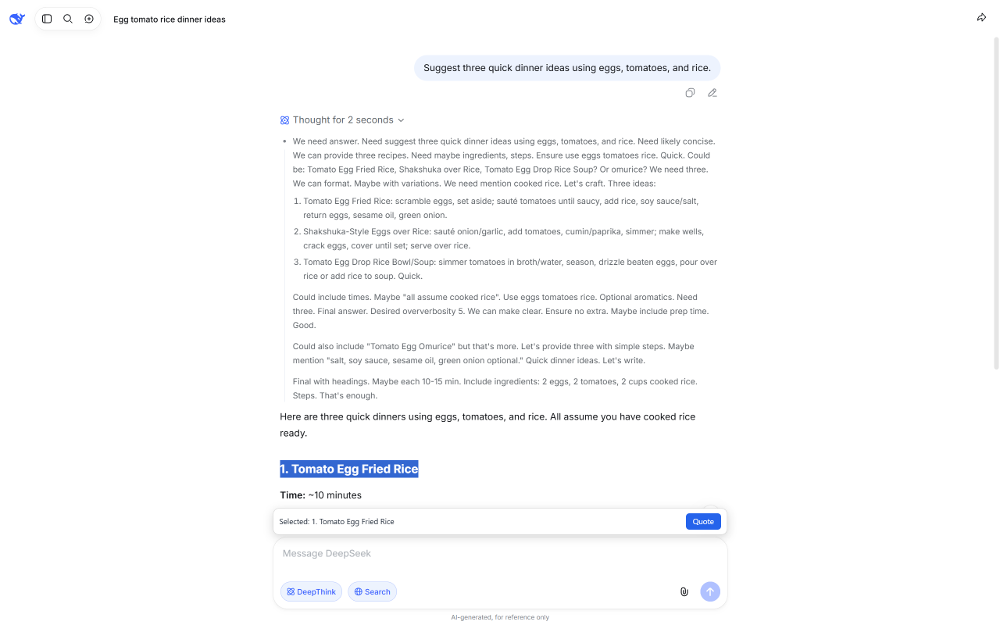
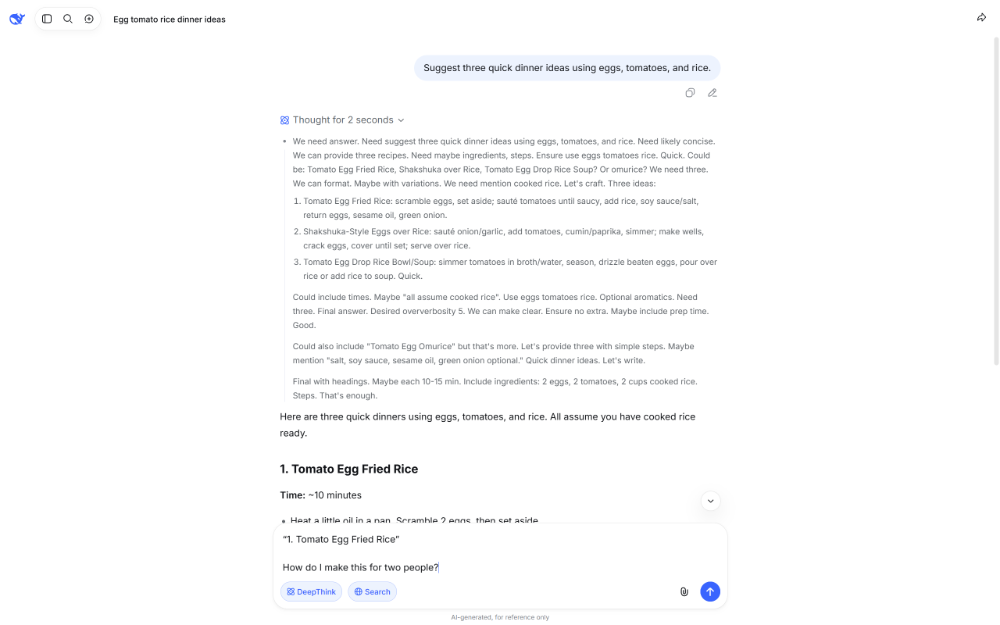

**[Install from the Chrome Web Store](https://chromewebstore.google.com/detail/deepseek-enhancer/eaenmoclonobobodnhnnakgbiafdcide)**

<p align="center">
  
</p>

<h1 align="center">DeepSeek Enhancer</h1>

<p align="center">
  <a href="https://github.com/jiang1997/chrome-deepseek-enchance-plugin/actions/workflows/ci.yml"></a>
  <a href="https://github.com/jiang1997/chrome-deepseek-enchance-plugin/releases"></a>
  <a href="LICENSE"></a>
</p>

Select text in a DeepSeek response and quote it into the composer to keep asking. The extension runs locally and does not upload chat content.

## How it works

1. Select text in a response on `https://chat.deepseek.com/`.
2. A prompt matching the composer's width appears directly above the composer, with a selection preview and a Quote button.
3. Keep the text selected and click Quote. Clearing the selection (including clicking elsewhere or focusing the composer) immediately closes the prompt and discards the pending quote. A new valid selection replaces the preview.
4. The selected text is appended to your current draft as `“selected text”`, with the cursor after the quote. The prompt closes after a successful insertion; insertion failures show a temporary hint in place of the preview. Select the text again to retry.
5. Keep typing, edit the quote, and send the message yourself. Existing draft text is preserved. Press Escape to discard a pending quote without changing your draft.

When the entire selection is an `http://`, `https://`, or `www.` address, a **Visit** link appears beside **Quote**. Click it to open the address in a new tab without changing your draft. Addresses starting with `www.` use HTTPS.

While the selection remains active, the preview is temporarily hidden when switching browser tabs or when the composer leaves the viewport, and returns when the composer is visible again. Switching conversations or refreshing the page clears pending quotes.

When the selection sits inside a conversation message, the quote also records where it came from, so the model can tell your words from its own:

```text
[Quote · assistant #2]
“A closure keeps the lexical environment it could access when it was created.”
```

Role is read from the page's message content classes. For a selection contained in one message, the extension loads the current chat history and follows that message's original parent chain to an explicit root. The ordinal counts messages of the same role along that branch, including the quoted message; alternative versions on sibling branches do not increase it. This works even when earlier bubbles have been unmounted by the virtual list, and does not depend on the history's current-node pointer.

The quote preview appears immediately with DOM provenance, then updates when history resolves. Clicking Quote while history is loading waits for that lookup before inserting the labelled text. History and the conversation tree share an in-memory cache and pending request; a missing target triggers one refresh. Cancelling the selection or changing conversations prevents a delayed result from updating or inserting an old quote.

Missing ancestors, cycles, unknown ancestor roles, or a history failure fall back to DOM counting, which is only trusted when the virtual list explicitly renders from the first message. If neither source can establish the ordinal, the label contains only `assistant` or `user`. Selections spanning multiple messages, or with an unknown role, fall back to plain `“selected text”`.

The quote prompt follows DeepSeek’s light/dark page theme, including theme switches while a quote is pending. If the page has no explicit theme, it follows the system color preference.

## Conversation tree

Click **Conversation tree** at the top right of a DeepSeek page to open a message tree. User messages are blue, DeepSeek replies green, and inactive branches gray. Hover or focus a node to preview its text; click a node on the current branch to scroll to and highlight that message. Search highlights matching nodes across all branches. The reading-position ring follows page scrolling, and the panel follows the page theme.

Search selects the first match in tree order (parent before children, including other branches). Use **Previous search result** / **Next search result**, or **Shift+Enter** / **Enter** in the search box, to cycle through matches. The counter shows the current result and total, such as `3 / 12`. Results are previewed and brought into view inside the tree; searching does not scroll the chat or switch branches. Amber halos show matches, with an amber outline on the current result; the blue reading-position ring remains visible independently.

Opening the panel reveals the message currently being read. **Reading position** brings that message back into view in the tree after you have explored elsewhere, without moving the chat or clearing your search. The button is disabled when no visible message can be associated with the tree. Refreshing preserves the current search result by message ID, the tree's scroll position, and keyboard focus; changing conversations clears the search.

The panel and quote provenance share the current conversation's history from DeepSeek using the existing page login state. Opening the panel or selecting text within a known message can trigger a history request. It refreshes every 15 seconds while the tab is visible, or when you click Refresh. No credentials or conversations are sent to the extension developer, and the credential remains in the page execution world. Conversation data stays in memory and is cleared on navigation or page reload.

If history cannot be read, the panel shows only currently rendered messages as separate nodes, with an explicit notice that their parent relationships are unknown. Other branches can be previewed, but automatic branch switching is not implemented; use DeepSeek's branch controls, then refresh the tree. Locating messages in a virtual list is best-effort and reports when a target cannot be mounted.

In this DOM fallback, assistant previews prefer the formal answer container, then Markdown blocks outside the thinking area. Thinking blocks, code toolbars, and message controls are excluded from the preview without changing the page or its selection. Messages with only a thinking area show “Only thinking content is rendered.” instead of presenting that content as an answer.

## Screenshots

| 1. Select & Quote | 2. Ask a Follow-up |
| :---: | :---: |
| [](store-assets/screenshots/01-select-and-quote.png) | [](store-assets/screenshots/02-follow-up-draft.png) |
| Select text in a response, then click **Quote**. | Add your follow-up question to the quoted draft. |

Click either screenshot to view the full-size image.

## Install from a ZIP file

Building from source requires Node.js 26 or newer. Run `nvm use` to select the version in `.nvmrc` if you use nvm.

```sh
npm install
npm run pack:zip
```

The output is `release/deepseek-enhancer-<version>-unpacked.zip` (ignored by Git). To install it:

1. Extract the ZIP file to a permanent directory.
2. Open `chrome://extensions` and enable **Developer mode**.
3. Click **Load unpacked**.
4. Select the extracted directory that directly contains `manifest.json`.

Keep the extracted directory in place after installation.

## Install from source

```sh
npm install
npm run build
```

Then use **Load unpacked** in `chrome://extensions` and select the generated `dist/` directory.

## Check the extension

- Select text in a response, including a list or code block. A prompt should appear above the composer.
- The prompt preview shows the source badge (for example `Selected assistant #2: ...`) when it can be resolved.
- Click Quote. The composer appends the labelled quote; the cursor stays after it.
- Quoting your own earlier message labels it as `user #N`.
- Existing draft text stays intact. You can keep typing, edit, and send manually.
- Clearing or collapsing the selection immediately closes the prompt without changing the draft. Press Escape to dismiss it.
- Scrolling and resizing keep the prompt aligned; it returns after the composer comes back into view. Changing chats clears it.
- Selecting text inside the composer clears the pending quote. Selections over 5,000 characters discard the previous quote and show a temporary hint.

`fixtures/mock-chat.html` provides a mock conversation for local checks. Its `window.__mockDeepSeek` controller can stream answers, replace the composer, switch chats, and mount/unmount a virtual message window on scrolling. See [fixture controls and browser scenarios](fixtures/README.md). `npm run inspect:deepseek` runs a read-only diagnostic against the live DeepSeek page (reachability plus composer candidates); it loads no extension and asserts no quote behavior.

Verified so far: real-page quote flow and English UI. Not yet fully covered: every zoom level, every editor branch, and the full dark/light regression matrix.

## Development commands

- `npm run format`: apply the shared Biome formatting rules.
- `npm run format:check`: check formatting without modifying files.
- `npm run lint`: run Biome lint rules without checking formatting.
- `npm run lint:fix`: apply safe lint fixes without formatting files.
- `npm test`: run unit tests with Vitest.
- `npm run check:tree`: load the production extension in Chromium against mocked DeepSeek history and verify quoting, the tree UI, and dynamic page scenarios (run `npm run build` first).
- `npm run typecheck`: check extension/test TypeScript types, then tooling TypeScript types.
- `npm run typecheck:scripts`: check `scripts/**/*.ts` and `tests/scripts/**/*.ts` using strict NodeNext settings, without emitting files.
- `npm run build`: create the production extension in `dist/`.
- `npm run inspect:deepseek`: diagnose the live DeepSeek page structure; screenshots go to `artifacts/`.
- `npm run pack:zip`: build the store upload ZIP.

Biome formats supported files under `src/`, `tests/`, and `scripts/`, fixture JavaScript, plus root JSON and TypeScript files. The shared rules use 2 spaces, LF line endings, a 120-character line width, double quotes, semicolons, and trailing commas in JavaScript/TypeScript. Import sorting remains disabled. Markdown, HTML, YAML, and generated files are outside this formatting scope. CI checks formatting separately from lint; production builds enforce both through `biome ci`.

CI runs `check:tree` after building the extension and installing Chromium. The check uses mocked DeepSeek responses and requires no account. For local setup, run `npx playwright install chromium` first. Screenshots are saved in `artifacts/tree-check/`; failures also save an error report and `trace.zip`. CI uploads these diagnostics with the run log as `tree-check-diagnostics` on failure (retained for 7 days). Open a trace with `npx playwright show-trace artifacts/tree-check/trace.zip`.

Store listing sources, screenshots, and release steps: `store-assets/README.md`.

Tooling scripts run directly with Node.js 26's native TypeScript support, without a build step or an extra runner. Use explicit `.ts` extensions for relative imports and `import type` for types. The script configuration enforces erasable TypeScript syntax; runtime enums, parameter properties, and path aliases are not supported. Node only strips types at runtime, so `npm run typecheck` remains required. Tooling tests live under `tests/scripts/` and are checked separately from browser extension code.

Automated store upload and review submission: [GitHub Actions publishing guide](store-assets/automated-publishing.md).

## Optional local CRX

For managed or automated local distribution only; the Chrome Web Store does not need it:

```sh
npm run init:crx-key
npm run pack:crx
```

The private key at `keys/deepseek-enhancer.pem` is gitignored. Back it up; losing it changes the extension ID for CRX installs. Store signing is managed separately by Google.

## Privacy

The content script runs only on `chat.deepseek.com`. The extension requests no tabs, storage, cookies, or additional host permissions. Selected text and the existing draft are processed locally for the quote feature. When you open the conversation tree or select text within a known message, the page-world script reads the existing login token to request history from the same DeepSeek origin; the token is not passed to the isolated content script. The extension does not transmit this content to the developer or persist it in storage.

Privacy policy: https://jiang1997.github.io/chrome-deepseek-enchance-plugin/privacy.html

## Limitations

DeepSeek may change its composer or page structure. Dark mode and browser zoom still need full manual regression coverage. Message role detection depends on DeepSeek's message-list DOM; it degrades to an unlabelled quote if those hooks change. Ordinals are omitted when history cannot establish a complete, known-role ancestor chain and the DOM fallback cannot count reliably.
